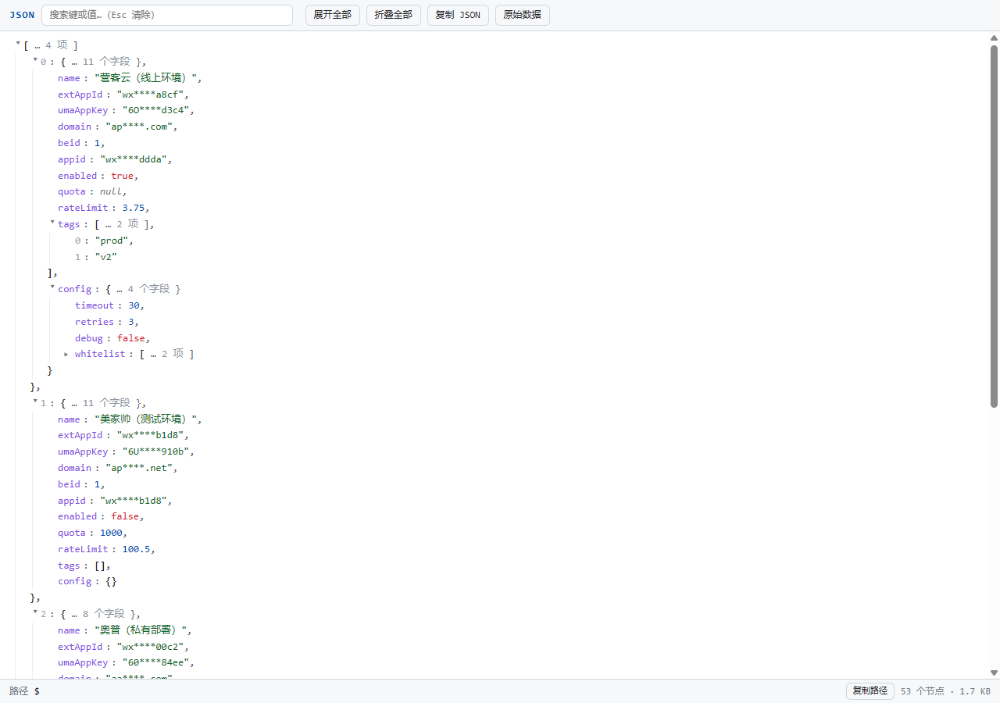

# JSON 美化查看器（Firefox 风格）— Chrome 扩展

[English](README.en.md) | 简体中文

用 Firefox 风格的树形视图替换 Chrome 自带的 JSON 查看（即"美观输出"那一页）：
**可折叠、语法高亮、搜索、路径显示、一键复制**。打开任何 `application/json` 页面自动生效。



## 功能

- **自动接管**：检测到 `application/json`（含 `*+json`）页面时自动渲染为可折叠树，替代 Chrome 内置的"美观输出"；
  `text/plain` 的纯 JSON 文本页也会接管（页面几乎只含一段文本时）。
- **折叠**：点击行或箭头展开/折叠，折叠时显示 `{ … 11 个字段 }`、`[ … 20000 项 ]` 摘要；
  工具栏"展开全部 / 折叠全部"。
- **颜色区分**：键=紫、字符串=绿、数字=蓝、布尔=红、null=灰、数组下标=浅灰；
  自动跟随系统深色模式。
- **搜索**：键/值大小写不敏感匹配，高亮命中并自动展开所在路径，显示"N 处匹配"，Esc 清除。
- **路径**：点击任意键或值，底部状态栏显示其 JSONPath 风格路径（如 `$.data[0].config.timeout`），可一键复制路径。
- **复制**：双击值复制该值；"复制 JSON"复制格式化全文。
- **原始数据**：在树形与原始文本间切换。
- **大文件友好**：按节点预算自适应默认展开深度，6 万节点为渲染上限（超出在状态栏提示，不会卡死页面）。
- **手动兜底**：点击工具栏扩展图标可强制美化当前页（例如以 `text/html` 返回的 JSON 接口）；已美化时点击可切换树形/原始视图。

## 安装（加载已解压的扩展程序）

1. 打开 Chrome，地址栏输入 `chrome://extensions` 回车；
2. 打开右上角 **开发者模式**；
3. 点击左上角 **加载已解压的扩展程序**，选择本目录（`chrome-json-viewer`）；
4. 打开任意 JSON 接口地址（如 `https://api.example.com/xxx.json`）即可看到新视图。

> 提示：查看本地 `.json` 文件（`file://`）需在 `chrome://extensions` 中对该扩展开启"允许访问文件网址"。

## 测试

本仓库自带测试服务器与端到端脚本：

```bash
node test/server.js   # 本地测试服务 http://127.0.0.1:18080
node test/e2e.js      # 需 Node 22+；自动启动无头 Chrome、加载本扩展并验证
```

测试页面（扩展安装后访问）：

| 页面 | 预期 |
| --- | --- |
| `/sample.json`（application/json） | 自动接管为树形视图 |
| `/sample.txt`（text/plain） | 自动接管 |
| `/notjson.txt` | 不接管，保持原样 |
| `/big.json`（3.67 MB / 2 万条） | 约 3 秒内可浏览，展开有预算保护 |
| `/harness.html#__jv_force` | 不装扩展也能直接调试渲染逻辑 |

端到端已验证：自动接管、Chrome 内置 `<pre>` 被替换、折叠/展开、搜索高亮与计数、路径显示、原始视图切换、text/plain 回退、非 JSON 不误伤、深色模式。

## 目录结构

```
chrome-json-viewer/
├── manifest.json        # MV3 清单（content_scripts + action + scripting）
├── background.js        # 工具栏图标点击 → 强制美化 / 切换视图
├── src/
│   ├── viewer.js        # 树形渲染器（折叠/高亮/搜索/路径，纯 DOM，无依赖）
│   ├── content.js       # 自动检测 JSON 页面并接管
│   ├── manual.js        # 手动触发入口
│   └── viewer.css       # 样式（浅色/深色，全部限定在 #jv-root 内）
├── icons/               # 16/32/48/128 图标
├── tools/make-icons.js  # 图标生成脚本（纯 Node，无依赖）
└── test/                # 本地服务器、样例数据、CDP 端到端脚本、截图
```

## 工作原理

Chrome 对 `Content-Type: application/json` 的顶层文档会渲染成 `<body><pre>JSON文本</pre></body>`。
本扩展的 content script 检查 `document.contentType`，取出 `<pre>` 的文本，`JSON.parse` 成功后清空页面、
挂载自己的树形视图（懒渲染：折叠的容器不渲染子节点）。非 JSON 页面不做任何事。

## 已知边界

- 不处理以附件形式下载（`Content-Disposition: attachment`）的 JSON；
- 键重复时以 `JSON.parse` 结果为准（保留最后一个）；
- 超过 6 万节点的"展开全部"会截断并在状态栏提示，其余功能不受影响。
